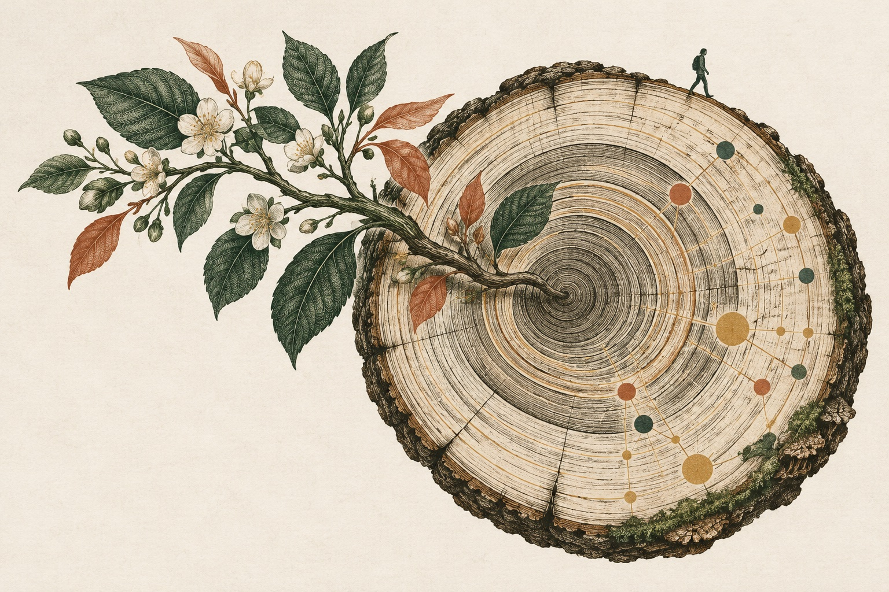

# Cẩm nang sống lâu hơn cho lập trình viên · HowToLiveLonger

**Giúp mọi người sống lâu hơn, khỏe mạnh hơn và vui vẻ hơn.**

[**Mở bản tiếng Việt sau khi tải về →**](index.html#lang=vi&view=table)

[Tiếng Việt](README.md) · [English](docs/readme/en.md) · [简体中文](docs/readme/zh-CN.md) · [Español](docs/readme/es.md) · [Français](docs/readme/fr.md) · [Deutsch](docs/readme/de.md) · [Português](docs/readme/pt.md) · [日本語](docs/readme/ja.md) · [العربية](docs/readme/ar.md)



Khám phá 64 bản tóm tắt nghiên cứu về ăn uống, vận động, giấc ngủ và thói quen hằng ngày, kèm gợi ý thực tế và liên kết đến các nghiên cứu gốc. Mức độ bằng chứng và giới hạn của từng nghiên cứu được trình bày riêng; các số liệu liên quan không phải lời hứa tăng tuổi thọ cho mỗi người.

Để đọc ngoại tuyến, [tải kho mã nguồn](https://github.com/ninhhaidang/HowToLiveLonger/archive/refs/heads/main.zip), giải nén rồi mở `index.html`.

## Dành cho AI agent

```sh
npx skills add ninhhaidang/HowToLiveLonger --skill howtolivelonger
```

Skill trên đọc [JSON dữ liệu nghiên cứu gốc](data/evidence.json) và trả lời kèm nguồn bài báo. Muốn xem bản diễn giải tiếng Việt trong trang web, chọn Tiếng Việt hoặc mở [bản tiếng Việt](index.html#lang=vi&view=table).

[Đóng góp](docs/CONTRIBUTING.vi.md) · [Giấy phép](LICENSE) · [Bản dịch giấy phép để tham khảo](LICENSE_vi.md) · [Bản dịch README cũ (lưu trữ)](docs/original-readme.vi.md)
