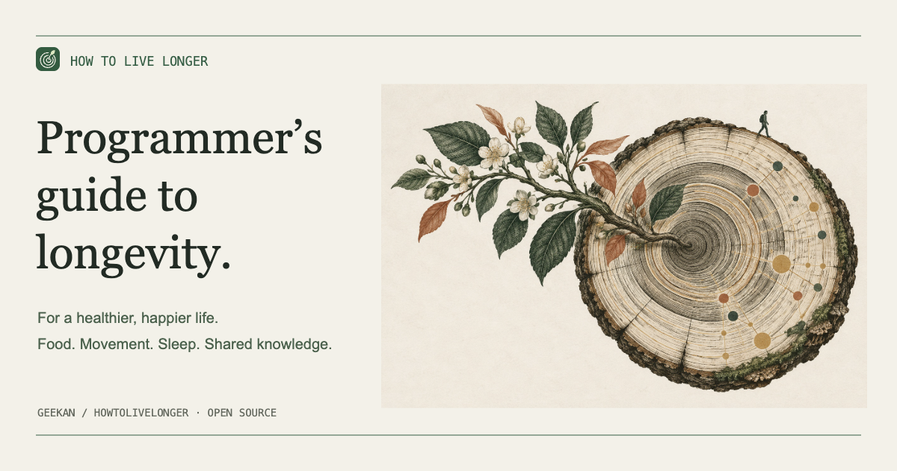

# A Programmer’s Guide to Longevity · HowToLiveLonger

**Helping everyone live a longer, healthier, happier life.**

[**Read online →**](../../index.html#lang=en&view=table)

[Tiếng Việt](../../README.md) · [English](en.md) · [简体中文](zh-CN.md) · [Español](es.md) · [Français](fr.md) · [Deutsch](de.md) · [Português](pt.md) · [日本語](ja.md) · [العربية](ar.md)

[](../../index.html#lang=en&view=table)

Explore 64 research summaries on food, exercise, sleep and everyday habits, with practical takeaways and links to the original studies.

For offline reading, [download the repository](https://github.com/ninhhaidang/HowToLiveLonger/archive/refs/heads/main.zip), unzip it and open `index.html`.

## For AI agents

```sh
npx skills add ninhhaidang/HowToLiveLonger --skill howtolivelonger
```

Reads the [research JSON](../../data/evidence.json) and answers with study sources.

[Contribute](../../CONTRIBUTING.md) · [License](../../LICENSE)
